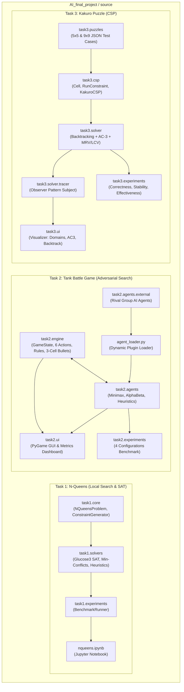
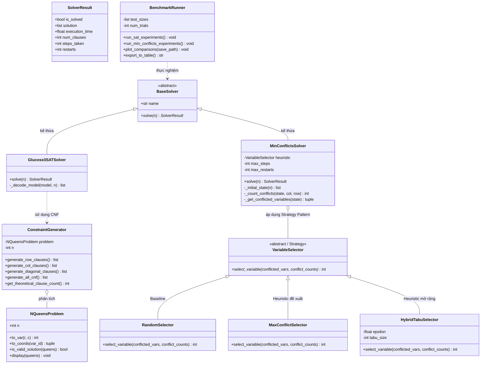
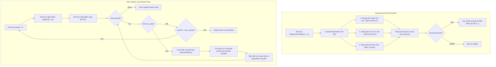
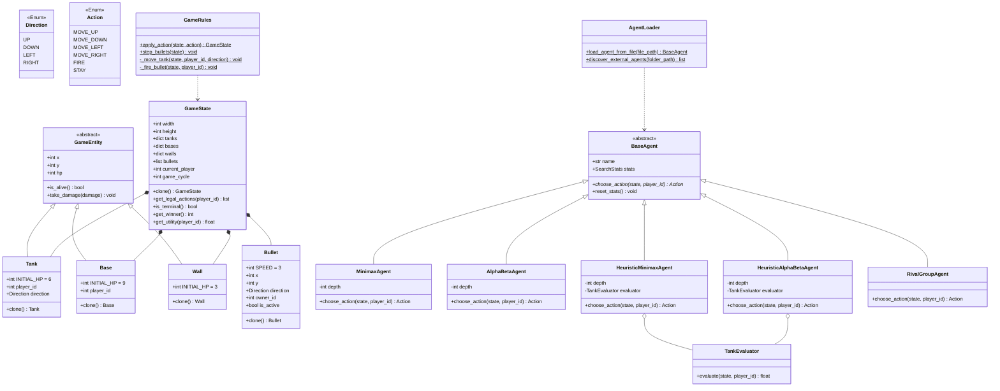
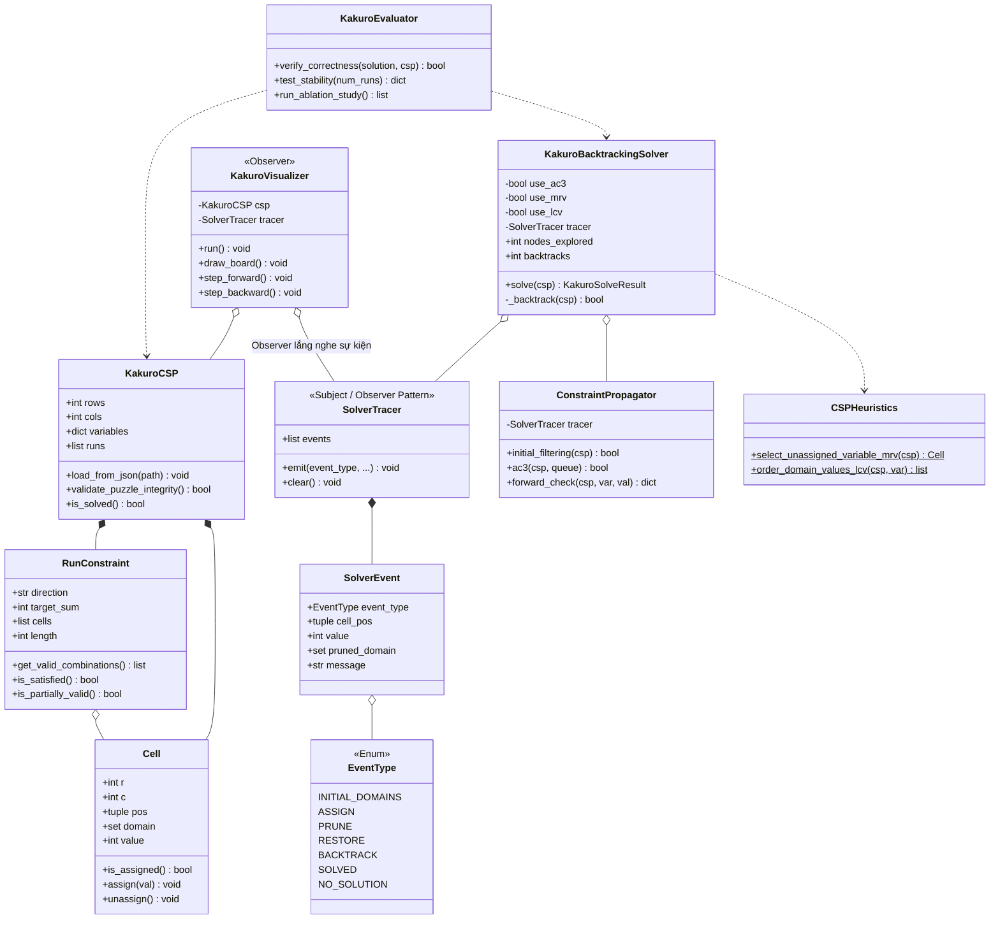
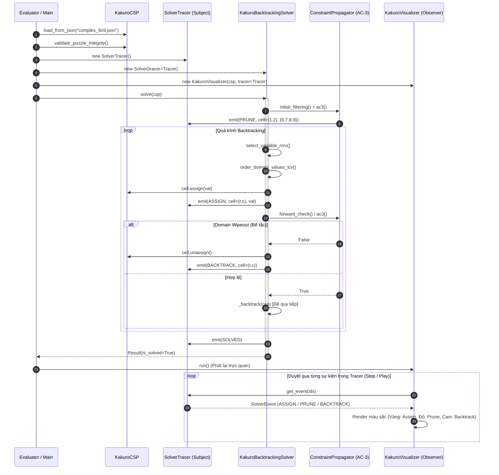
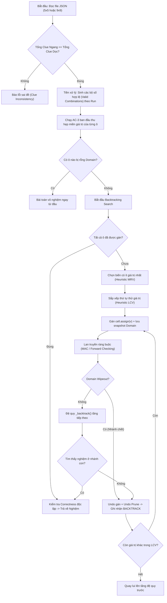

**Môn học:** Introduction to Artificial Intelligence (503043) — Khoa CNTT, Đại học Tôn Đức Thắng (TDTU)
> 📌 **Tài liệu này cung cấp:**
> 1. Toàn bộ sơ đồ lớp hướng đối tượng (**Class Diagram OOP**) chi tiết của cả 3 Task.
> 2. Các sơ đồ tuần tự (**Sequence Diagram**) và sơ đồ quy trình (**Flowchart**) giải thích nguyên lý hoạt động của các giải thuật.
> 3. Các mẫu thiết kế (**Design Patterns**) được áp dụng: *Strategy Pattern*, *Observer Pattern*, *Plugin/Dynamic Loading Pattern*.
> 4. Toàn bộ file nguồn chuyên dụng đã được lưu tại thư mục [docs/diagrams/]
>    - **PlantUML (`.puml`):** Chuẩn chuyên dụng cho vẽ sơ đồ kỹ thuật phần mềm (mở bằng extension PlantUML trong VS Code).
>    - **Mermaid (`.mmd`):** Hiển thị trực tiếp trong Markdown của VS Code, GitHub, Overleaf và Obsidian.

---

## 1. TỔNG THỂ KIẾN TRÚC DỰ ÁN (OVERALL ARCHITECTURE)

### 1.1 Sơ đồ Phân rã Gói (Package Architecture)

---

## 2. TASK 1: N-QUEENS (SAT & MIN-CONFLICTS)

### 2.1 Biểu đồ Lớp Chi tiết (Class Diagram OOP)


- **File PlantUML nguồn:** [task1_nqueens_class.puml]
- **Điểm sáng thiết kế OOP:**
  - **Strategy Pattern:** Lớp trừu tượng `VariableSelector` cho phép hoán đổi linh hoạt giữa chiến lược ngẫu nhiên `RandomSelector` (Baseline) và `MaxConflictSelector` (Heuristic đề xuất) mà không phải sửa lại giải thuật trong `MinConflictsSolver`.
  - **Polymorphism & Abstraction:** Cả SAT solver và Min-Conflicts solver đều kế thừa `BaseSolver` và trả về cấu trúc `SolverResult` đồng nhất để phục vụ tự động hóa đo lường.

### 2.2 Sơ đồ Quy trình Nguyên lý Hoạt động (Operational Flowchart)


- **File PlantUML nguồn:** [task1_nqueens_flow.puml]

---

## 3. TASK 2: TANK BATTLE GAME (ADVERSARIAL SEARCH)

### 3.1 Biểu đồ Lớp Chi tiết (Class Diagram OOP)


- **File PlantUML nguồn:** [task2_tank_class.puml]
- **Điểm sáng thiết kế OOP:**
  - **Kế thừa & Đóng gói Entity:** `GameEntity` đóng gói `x`, `y`, `hp`, `take_damage()` giúp tái sử dụng mã cho `Tank` (HP 6), `Base` (HP 9), và `Wall` (HP 3).
  - **Interface chuẩn `BaseAgent`:** Cung cấp hàm `choose_action(state, player_id)`. Mọi thuật toán (của nhóm hay của nhóm sinh viên khác) đều kế thừa từ lớp này.
  - **Dynamic Plugin Loader (`AgentLoader`):** Sử dụng thư viện `importlib` của Python để nạp động các file `.py` ngoài mà không cần sửa code hệ thống.

### 3.2 Sơ đồ Tuần tự Một Chu kỳ Game (Game Cycle Sequence Diagram)
Sơ đồ minh họa nguyên lý xử lý đạn bay **3 ô / cycle** và **kiểm tra va chạm cell-by-cell**:

```mermaid
sequenceDiagram
  autonumber
  participant Loop as GameEngine / Main
  participant GUI as PygameUI
  participant S as GameState
  participant P0 as Agent P0 (MAX)
  participant P1 as Agent P1 (MIN)
  participant R as GameRules
  participant E as Entities (Wall/Tank/Base)

  loop Mỗi Game Cycle
    Loop->>P0: choose_action(state, 0)
    P0-->>Loop: action_p0 (ví dụ FIRE hoặc MOVE_UP)
    Loop->>R: apply_action(state, action_p0)
    
    Loop->>P1: choose_action(state, 1)
    P1-->>Loop: action_p1
    Loop->>R: apply_action(state, action_p1)
    
    rect rgb(240, 248, 255)
      note over R, E: Xử lý đạn: Tối đa 3 ô, kiểm tra va chạm TỪNG Ô (Cell-by-Cell)
      loop Bước k = 1, 2, 3
        R->>R: Di chuyển đạn 1 ô theo hướng bắn
        R->>S: check_collision(bullet.x, bullet.y)
        alt Trúng Tường (Wall)
          R->>E: wall.take_damage(1)
          R->>R: Đạn dừng & biến mất ngay lập tức (is_active = False)
        else Trúng Tank
          R->>E: tank.take_damage(1)
          R->>R: Đạn dừng & biến mất ngay lập tức
        else Trúng Base
          R->>E: base.take_damage(1)
          R->>R: Đạn dừng & biến mất ngay lập tức
        else Vượt biên
          R->>R: Đạn biến mất
        end
      end
    end
    
    Loop->>S: is_terminal()
    alt Game Kết Thúc (Base hoặc Tank HP <= 0)
      S-->>Loop: True (Game Over)
      Loop->>GUI: render_game_over(winner)
    else Tiếp tục
      Loop->>GUI: render(state, p0, p1)
    end
  end
```

- **File PlantUML nguồn:** [task2_tank_sequence.puml]

---

## 4. TASK 3: KAKURO PUZZLE (CSP)

### 4.1 Biểu đồ Lớp Chi tiết (Class Diagram OOP)


- **File PlantUML nguồn:** [task3_kakuro_class.puml]
- **Điểm sáng thiết kế OOP:**
  - **Observer Pattern:** Tách rời hoàn toàn thuật toán tìm kiếm (`KakuroBacktrackingSolver`) khỏi giao diện đồ họa (`KakuroVisualizer`). Khi solver thực hiện gán (`ASSIGN`), tỉa miền giá trị (`PRUNE`), hoặc quay lui (`BACKTRACK`), nó phát sự kiện tới `SolverTracer`. `KakuroVisualizer` chỉ cần duyệt danh sách sự kiện này để vẽ trực quan hóa từng bước mượt mà (có thể Pause, Step, Reverse).

### 4.2 Sơ đồ Tuần tự Observer Pattern giữa Solver, Tracer và UI


- **File PlantUML nguồn:** [task3_kakuro_sequence.puml]
### 4.3 Sơ đồ Quy trình Thuật toán CSP Kakuro (Solver Flowchart)


- **File PlantUML nguồn:** [task3_kakuro_flow.puml]

---

## 5. BẢNG TỔNG HỢP CÁC FILE SƠ ĐỒ CHUYÊN DỤNG TRONG THƯ MỤC `docs/diagrams/`

| Tên File | Định dạng | Nội dung sơ đồ |
| :--- | :---: | :--- |
| [overall_architecture.puml]| PlantUML | Kiến trúc tổng thể toàn bộ hệ thống dự án |
| [overall_architecture.mmd]| Mermaid | Kiến trúc tổng thể dạng sơ đồ Mermaid |
| [task1_nqueens_class.puml]| PlantUML | Biểu đồ lớp chi tiết Task 1 (Strategy Pattern Heuristic) |
| [task1_nqueens_flow.puml]| PlantUML | Quy trình Glucose3 SAT & Min-Conflicts Local Search |
| [task1_diagrams.mmd]| Mermaid | Sơ đồ lớp Task 1 hiển thị bằng Mermaid |
| [task2_tank_class.puml]| PlantUML | Biểu đồ lớp chi tiết Task 2 (Entities, 4 AI Agents, Loader) |
| [task2_tank_sequence.puml]| PlantUML | Sơ đồ tuần tự 1 Game Cycle & va chạm đạn cell-by-cell |
| [task2_diagrams.mmd]| Mermaid | Sơ đồ lớp Task 2 hiển thị bằng Mermaid |
| [task3_kakuro_class.puml]| PlantUML | Biểu đồ lớp chi tiết Task 3 (CSP, Observer Pattern, UI) |
| [task3_kakuro_sequence.puml]| PlantUML | Sơ đồ tuần tự Observer Pattern giữa Solver, Tracer và UI |
| [task3_kakuro_flow.puml]| PlantUML | Quy trình giải CSP: AC-3, MRV, LCV và Backtracking |
| [task3_diagrams.mmd]| Mermaid | Sơ đồ lớp Task 3 hiển thị bằng Mermaid |
| [architecture_and_design_diagrams.md]| Markdown | Toàn bộ tài liệu phân tích thiết kế kèm preview Mermaid trực quan |